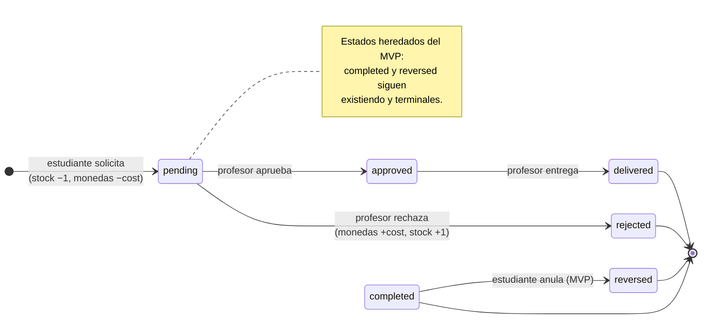

# Propuesta de esquema — Canje revisable (H7.1)

> **Estado:** 🟢 **APROBADO el 2026-11-10** (veredicto del responsable actual del proyecto, con las
> 6 decisiones de §5 — incluida la columna `auto_approve` de §2.6). Registrado en
> [PRO-447](https://linear.app/projectsu/issue/PRO-447).
> La **migración** la ejecuta H7.2 (T7.2.1) en su propio flujo: aquí **no se ejecutó ninguna**
> (CA 3).
> **Ticket:** PRO-447 · **Sub-tareas:** PRO-459 (SQL) · PRO-460 (contrato) · PRO-461 (impacto).
> **Rama:** `s6_h7_1_canje_revisable_esquema` · **Spec:** `spec/features/046-h7-1-canje-revisable-esquema/`.
> **Fuente de verdad del esquema actual:** `db/001_schema.sql` (no el diseño pre-MVP).

---

## 1. Contexto y objetivo

El MVP canjea **instantáneamente**: `redemptions.status` nace en `completed` (`DEFAULT`), descuenta
stock en un `BEFORE INSERT`, descuenta monedas en un `AFTER INSERT` y solo permite la anulación
estudiantil `completed → reversed`. El backlog pide el flujo revisable por el profesor:
**`pendiente → aprobado | rechazado → entregado`**, con reversión íntegra de monedas y stock al
rechazar.

**Objetivo de esta propuesta:** dejar por escrito el cambio exacto (DDL + contrato de estados +
checklist de impacto) para que el equipo lo apruebe antes de implementar.

**Alcance de la propuesta:** enum ampliado, columnas de resolución, índice de la cola, trigger de
reversión al rechazar, diagrama de transiciones y checklist de impacto. **No incluye** ejecutar la
migración ni modificar código de la API o la UI.

---

## 2. Especificación SQL ← *T7.1.1 / PRO-459*

### 2.1 Enum ampliado

Objetivo: `redemption_status` pase de 2 a 6 valores, **conservando** los heredados.

```sql
-- Se ejecuta FUERA de la transacción que vaya a usar los valores nuevos
-- (ver §2.5). El orden importa: 'pending' … 'delivered' entran ANTES de
-- 'completed' para que ORDER BY status refleje la máquina de estados.
ALTER TYPE redemption_status ADD VALUE IF NOT EXISTS 'pending'   BEFORE 'completed';
ALTER TYPE redemption_status ADD VALUE IF NOT EXISTS 'approved'  BEFORE 'completed';
ALTER TYPE redemption_status ADD VALUE IF NOT EXISTS 'rejected'  BEFORE 'completed';
ALTER TYPE redemption_status ADD VALUE IF NOT EXISTS 'delivered' BEFORE 'completed';
```

Resultado final (orden de declaración del tipo):

```
pending | approved | rejected | delivered | completed | reversed
└── nuevos ──────────────────────────────┘  └── heredados (MVP) ──┘
```

### 2.2 Columnas de resolución y coherencia

```sql
ALTER TABLE redemptions
  ADD COLUMN resolved_by BIGINT REFERENCES users(id),
  ADD COLUMN resolved_at TIMESTAMPTZ;

-- Un canje resuelto DEBE traer auditoría completa…
ALTER TABLE redemptions
  ADD CONSTRAINT ck_redemption_resolved_audit
  CHECK ( status NOT IN ('approved','rejected','delivered')
          OR (resolved_by IS NOT NULL AND resolved_at IS NOT NULL) );

-- …y un pendiente NO debe tener auditoría de resolución.
ALTER TABLE redemptions
  ADD CONSTRAINT ck_redemption_pending_clean
  CHECK ( status <> 'pending'
          OR (resolved_by IS NULL AND resolved_at IS NULL) );
```

- `resolved_by`: id del **profesor** que resuelve (FK a `users`; que sea el profesor de la clase es
  regla de la aplicación — `docs/guard_pertenencia.md`, AGENTS.md §8/§9.7).
- `resolved_at`: instante de la resolución (`TIMESTAMPTZ`, igual que el resto del esquema).
- **Compatibilidad:** ambas restricciones aceptan las filas existentes (`completed`/`reversed` no
  pertenecen al conjunto auditado y `resolved_*` son `NULL` en todas ellas) — verificado en §6.
- `reversed_at` **no** se reutiliza para el rechazo (su semántica es "anulación del estudiante");
  la devolución de un rechazo queda atada a `resolved_at`. *(Alternativa sometida al PO en §5.)*

### 2.3 Índice de la cola de pendientes

```sql
CREATE INDEX idx_redemptions_pending
  ON redemptions (redeemed_at)
  WHERE status = 'pending';   -- parcial, mismo patrón que uq_movement_* (§11 del esquema)
```

Alimenta la cola paginada del profesor de H7.2/H7.4 sin barrer canjes ya resueltos.

### 2.4 Trigger de reversión al rechazar (monedas + stock, misma transacción)

**Decisión: extender `fn_reverse_redemption`** en lugar de crear un trigger nuevo — una sola fuente
de reversión, sin dos disparadores que puedan divergir (trade-off documentado en §7).

```sql
CREATE OR REPLACE FUNCTION fn_reverse_redemption() RETURNS trigger
LANGUAGE plpgsql AS $$
BEGIN
    -- Camino heredado del MVP (anulación del estudiante): SIN CAMBIOS
    IF NEW.status = 'reversed' AND OLD.status <> 'reversed' THEN
        NEW.reversed_at := COALESCE(NEW.reversed_at, now());
        INSERT INTO coin_movements (enrollment_id, type, quantity, redemption_id, description)
        VALUES (NEW.enrollment_id, 'reversal', NEW.cost_coins, NEW.id, 'Redemption reversed');
        UPDATE redeemable_items SET stock = stock + 1
         WHERE id = NEW.item_id AND stock IS NOT NULL;

    -- Camino nuevo: SOLO pending → rejected
    --   · OLD.status = 'pending' es el guard de transición (nunca dos veces)
    --   · uq_movement_reversal (único parcial) aborta ante un segundo intento
    ELSIF NEW.status = 'rejected' AND OLD.status = 'pending' THEN
        INSERT INTO coin_movements (enrollment_id, type, quantity, redemption_id, description)
        VALUES (NEW.enrollment_id, 'reversal', NEW.cost_coins, NEW.id, 'Redemption rejected');
        UPDATE redeemable_items SET stock = stock + 1
         WHERE id = NEW.item_id AND stock IS NOT NULL;
    END IF;
    RETURN NEW;
END $$;
-- El trigger sigue siendo trg_redemptions_reverse (AFTER UPDATE OF status ON redemptions).
```

**Lo que NO cambia** (reserva al solicitar, decisión del plan en `docs/post_mvp.md` Parte II):

- `fn_execute_redemption` (BEFORE INSERT): valida clase/ítem activo/stock → `stock − 1` y congela
  `cost_coins`/`grade_points`.
- `fn_register_redemption` (AFTER INSERT): inserta el movimiento `spending` (−`cost_coins`); si no
  alcanza el saldo, `ck_enrollment_no_negative` aborta todo.
- `fn_apply_movement`: sigue sincronizando `enrollments.coins_earned/coins_spent` con cada
  movimiento, incluido el `reversal` del rechazo. **Nunca se escribe a mano.**

**Auditoría escrita por la aplicación:** `trg_redemptions_reverse` es `AFTER UPDATE`, donde
asignar a `NEW` **no persiste** (hallazgo documentado en `spec/features/025` §Supuestos 7 y ya
acotado en `src/modules/redemptions/redemptions.service.ts:215-221`). Por eso el backend hará
**un solo `UPDATE`** con `status` + `resolved_by` + `resolved_at`, y el trigger se queda
exclusivamente con monedas y stock.

### 2.5 Notas de ejecución (para quien aplique la migración en H7.2)

1. **Transacciones y `ADD VALUE`:** desde PostgreSQL 12 se puede ejecutar `ALTER TYPE … ADD VALUE`
   dentro de una transacción, pero el valor nuevo **no puede usarse hasta que la transacción
   confirme** (`unsafe use of new value of enum type`). Ejecutar los cuatro `ALTER TYPE` en su
   propia transacción y usar los valores recién después. *(El repo exige PostgreSQL 14+.)*
2. **No se borran valores:** PostgreSQL **no permite eliminar valores de un enum**. Revertir esta
   propuesta exigiría recrear el tipo (operación destructiva). Ésa es una de las razones por las
   que el enum solo se amplía **con aprobación previa**.
3. **El `DEFAULT` no cambia aquí:** `redemptions.status` sigue en `DEFAULT 'completed'` (compat
   total con el flujo instantáneo). Pasarlo a `pending` lo decide H7.2 (pregunta 3 de §5).
4. **Prisma en la misma migración:** `prisma/schema.prisma` (`enum redemption_status`, línea 227)
   debe ampliarse con los 4 valores y regenerarse (`pnpm prisma generate`) **en el mismo paso**;
   si la BD gana valores y el schema no, el cliente tipa mal las filas nuevas (T7.2.1).
5. **Validación previa:** `pnpm prisma validate` antes de aplicar nada.

### 2.6 Configuración de aprobación automática por ítem

**Decisión PO (2026-11-10):** hay canjes que el profesor pre-aprueba por política ("respuesta
automática") y otros que requieren su verificación manual (documentos / preguntas complejas).

```sql
-- Columna nueva en el catálogo (NO en redemptions): quién puede auto-aprobar.
ALTER TABLE redeemable_items
  ADD COLUMN auto_approve BOOLEAN NOT NULL DEFAULT FALSE;
```

- **`FALSE` (default):** el canje queda `pending` y espera la decisión del **profesor** (camino
  manual de §3.2).
- **`TRUE`:** la API, **en la misma transacción de la solicitud**, ejecuta `pending → approved`
  (actor: el sistema, siguiendo la política que el profesor configuró en el ítem).
- **Auditoría sin columna extra:** `approved` sigue exigiendo `resolved_by` + `resolved_at`
  (CHECK intacto); en la auto-aprobación `resolved_by` = **profesor de la clase** (autor de la
  política, pre-aprobación) y `resolved_at` = instante automático. Para distinguirlo, se lee
  `redeemable_items.auto_approve` (misma fila que el `item_id` del canje). *Alternativa dejada
  anotada: una columna `redemptions.auto_approved` si algún día hace falta distinguirlo sin JOIN
  (p. ej. si la política puede cambiar después de un canje).*
- **`delivered` no es automático:** lo marca el profesor cuando entrega el ítem (para
  `grade_bonus`, al materializar el bono). La auto-aprobación acelera la decisión, no la entrega.

---

## 3. Contrato de estados y transiciones ← *T7.1.2 / PRO-460*

### 3.1 Diagrama de estados



### 3.2 Tabla de transiciones (única fuente de verdad del contrato)

| # | Transición | Actor | Saldo (`enrollments`) | Stock (`redeemable_items`) | `coin_movements` | Auditoría |
|---|---|---|---|---|---|---|
| 0 | *(INSERT)* → `pending` | estudiante | `−cost_coins` | `−1` si es limitado | `spending` (1, único) | `redeemed_at` |
| 1 | `pending` → **`approved`** | **profesor** de la clase, o **el sistema** si `item.auto_approve = TRUE` (ver §2.6) | sin cambio | sin cambio | **ninguno** | app: `resolved_by`, `resolved_at` |
| 2 | `approved` → **`delivered`** | profesor (siempre manual; la auto-aprobación **no** entrega) | sin cambio | sin cambio | **ninguno** | (`resolved_*` ya llenos) |
| 3 | `pending` → **`rejected`** | profesor de la clase | `+cost_coins` (vuelta exacta) | `+1` si era limitado | `reversal` (1, único) | app: `resolved_by`, `resolved_at` |
| 4 | `completed` → `reversed` | estudiante dueño (MVP, **se retira en H7.2** — decisión §5.4) | `+cost_coins` | `+1` | `reversal` (1, único) | app: `reversed_at` |
| 5 | cualquier otra | — | ❌ **409** — `El canje ya fue resuelto` | | | |

- **Las únicas transiciones permitidas por la historia (CA 1) son 1, 2 y 3**; la 4 es la heredada
  del MVP y coexiste hasta H7.2.
- **Estados terminales:** `delivered`, `completed`, `reversed`. Todo intento de resolverlos ⇒ `409`.
- Toda resolución exige **autorización por recurso**: el profesor autenticado debe impartir la clase
  de la inscripción del canje; si no ⇒ `403` `No tienes permiso para resolver este canje`.
- **Costo congelado:** `cost_coins` se congela al solicitar y no se toca nunca más (una
  aprobación/rechazo posteriores no re-leen `redeemable_items.cost_coins`).

### 3.3 Payloads (contrato para H7.2 – H7.4; **no** se implementan en H7.1)

```
POST /api/v1/redemptions/:id/approve   → 200 { id, estado: "approved",  resueltoEn }
POST /api/v1/redemptions/:id/reject    → 200 { id, estado: "rejected",   resueltoEn }   ← dispara la reversión
POST /api/v1/redemptions/:id/deliver   → 200 { id, estado: "delivered",  resueltoEn }
```

- Sin cuerpo de entrada (la decisión es del profesor del JWT); ids como `string` (BigInt, AGENTS §7).
- Errores: `401` sin sesión · `403` `No tienes permiso para resolver este canje` · `404` canje
  inexistente o ajeno · `409` `El canje ya fue resuelto` (mensajes ya fijados en H7.2).
- **Atomicidad:** aprobación/rechazo en una sola transacción; si la reversión falla, la
  transacción completa se aborta (nunca un `rejected` sin devolución).
- La cola de pendientes (`GET …?page=&limit=` sobre `idx_redemptions_pending`) la consume H7.4.

---

## 4. Impacto y compatibilidad con el MVP ← *T7.1.3 / PRO-461*

### 4.1 Checklist de las 9 tablas del MVP + `fn_award_coins`

| # | Tabla | ¿Impacto? | Detalle |
|---|---|---|---|
| 1 | `organizations` | ❌ Ninguno | Sin referencia al enum ni a canjes |
| 2 | `users` | ⚪ Solo lectura | Nueva FK `redemptions.resolved_by → users(id)`; ninguna columna cambia |
| 3 | `classes` | ❌ Ninguno | — |
| 4 | `enrollments` | ⚪ Comportamiento | Sin cambios de esquema; `fn_apply_movement` contabiliza el `reversal` del rechazo y `ck_enrollment_no_negative` sigue blindando la reserva |
| 5 | `activities` | ❌ Ninguno | — |
| 6 | `submissions` | ❌ Ninguno | — |
| 7 | `redeemable_items` | ✅ **Sí (directo)** | Nueva columna `auto_approve` (§2.6); `stock −1` al solicitar y `+1` al rechazar (mismos triggers, sin cambios) |
| 8 | **`redemptions`** | ✅ **Sí (directo)** | Enum + 2 columnas + 2 `CHECK` + 1 índice parcial + trigger `fn_reverse_redemption` extendido |
| 9 | `coin_movements` | ⚪ Comportamiento | Sin cambios de esquema; nuevo `reversal` por rechazo. `ck_movement_coherent` ya admite `reversal` con `redemption_id` y `uq_movement_reversal` impide duplicados |

| Función | ¿Impacto? | Detalle |
|---|---|---|
| **`fn_award_coins`** | ❌ **Ninguno** | Solo depende de `submissions.status = 'graded'` y `activities.reward_coins`; ningún camino del canje la dispara ni la lee |
| `fn_execute_redemption` | ❌ Ninguno | Sin referencia a `status` (reserva al INSERT) |
| `fn_register_redemption` | ❌ Ninguno | Sin referencia a `status` |
| `fn_reverse_redemption` | ✅ Extendido | §2.4 |
| `fn_apply_movement` / `fn_validate_*` / `fn_set_updated_at` | ❌ Ninguno | — |
| Vistas `global_ranking` / `class_ranking` / `student_coins` | ❌ Ninguno | Siguen leyendo contadores; un rechazo no altera `coins_earned` (el ranking no baja) |

### 4.2 Inventario de puntos de escritura de `completed`/`reversed` (CA 2)

| Punto | Dónde | Tratamiento en la propuesta |
|---|---|---|
| `DEFAULT 'completed'` | `db/001_schema.sql:223` | **Se conserva.** El flujo instantáneo sigue naciendo igual hasta que H7.2 escriba `pending` explícito (pregunta 3) |
| Trigger de reversión | `db/001_schema.sql:434-449` | **Extendido** en §2.4 (el camino `reversed` queda intacto) |
| Anulación del estudiante | `src/modules/redemptions/redemptions.service.ts:263` (`anular()` → `reversed`) | **Se conserva** mientras coexistan ambos flujos; H7.3/H7.4 decidirán si sigue habiendo anulación estudiantil cuando todo sea revisable (fuera de H7.1) |
| Tipo en el DTO/util | `src/modules/redemptions/canje.util.ts:120`, `canje-respuesta.dto.ts:46` (tipo `redemption_status` del cliente generado) | **Se amplía** con `prisma generate` en T7.2.1; en H7.1 no se toca código |
| Enum en Prisma | `prisma/schema.prisma:227` + `@@default(completed)` (L125) | **Se amplía en la misma migración** (T7.2.1) — checklist de H7.2 |
| Contrato del front | `frontend/src/features/billetera/contrato/canje.ts:57` (`"completed" \| "reversed"`) | **Se amplía en H7.3** (billetera con estados) |
| Pruebas e2e | `test/redemptions.e2e-spec.ts`, `test/regresion-hito.e2e-spec.ts:582,908`, `test/rankings.e2e-spec.ts:362` | **Siguen verdes sin cambios**: el flujo instantáneo coexiste hasta H7.2; H7.5 añade las del flujo revisable |
| Seed | `db/002_seed.sql` | **Sin impacto**: no inserta filas en `redemptions` (verificado) |
| `prisma/migrations/0_init/migration.sql` | Copia del esquema inicial | No se edita; la ampliación va como migración nueva en H7.2 (T7.2.1) |

### 4.3 Migración del flujo actual

1. **Filas existentes:** ninguna se modifica. Los valores heredados siguen existiendo en el tipo y
   todas las filas conservan `completed`/`reversed` con su `reversed_at` legítimo.
2. **Restricciones nuevas:** ambas `CHECK` fueron diseñadas y **probadas** para aceptar esas filas
   (§6).
3. **Coexistencia:** hasta que H7.2 (T7.2.2) cambie la solicitud a `pending`, el INSERT sigue
   cayendo en el `DEFAULT 'completed'` → API, front y e2e **no perciben ningún cambio**.
4. **Cambio de mentalidad del "cancelar":** hoy `anular()` es del estudiante; en el flujo revisable
   la reversión de monedas/stock la dispara **solo** `pending → rejected` del profesor. Ambos
   caminos comparten el mismo trigger y el mismo índice anti-duplicados.
5. **Plan de reversión de la propuesta** (si se aplica y hay que deshacerla):
   `DROP CONSTRAINT ck_redemption_resolved_audit/ck_redemption_pending_clean` → `DROP INDEX
   idx_redemptions_pending` → `ALTER TABLE redemptions DROP COLUMN resolved_by, DROP COLUMN
   resolved_at`. **Los valores del enum no se pueden eliminar** (§2.5.2); por eso no se amplía sin
   aprobación.

---

## 5. Decisiones tomadas (aprobadas el 2026-11-10)

> Registradas por el responsable actual del proyecto (hoy único del equipo) y publicadas en
> [PRO-447](https://linear.app/projectsu/issue/PRO-447). Sustituyen a las preguntas abiertas de la
> primera iteración de la propuesta.

1. **Canje instantáneo del MVP:** **se retira al llegar H7.2** — la solicitud nace `pending` con
   reserva y desaparece el atajo `completed` del INSERT. (`completed`/`reversed` **siguen siendo
   valores válidos** del enum: CA 2 / §4.3.)
2. **`approved` y `delivered` se mantienen como dos pasos** (cumple literalmente el CA 1 de H7.1):
   `approved` = decisión, `delivered` = ítem entregado/materializado. Ajustar el texto de H7.2
   (Escenario 3 y T7.2.3.4), que hoy describe que aprobar va directo a `delivered`.
3. **Aprobación automática configurable por ítem:** `redeemable_items.auto_approve` (§2.6). Con
   "respuesta automática" el sistema hace `pending → approved` en la misma transacción; documentos
   o preguntas complejas (ítems sin auto-aprobación) esperan la **verificación manual** del
   profesor. `delivered` sigue siempre manual.
4. **`DEFAULT` de `redemptions.status`:** **se conserva `'completed'`**; la **API escribe
   `pending` explícito** al solicitar (H7.2, T7.2.2). Cero riesgo para el flujo instantáneo
   mientras coexista.
5. **Código de error por saldo/stock insuficiente: `422`** (igual que el canje instantáneo actual,
   spec 025). H7.2, T7.2.2.3 pasa de `400` a `422`.
6. **`reversed_at` no se llena en un rechazo:** solo `resolved_by`/`resolved_at`; `reversed_at`
   queda con la semántica de "anulación del estudiante".

---

## 6. Prueba en BD efímera (evidencia de "ejecutable en prueba")

Se ejecutó contra una **base descartable** creada para la ocasión (contenedor efímero con la misma
imagen `postgres:16` del proyecto, esquema `db/001_schema.sql` + `db/002_seed.sql`, **sin tocar
`educoin-db` ni ninguna base del equipo**; opción A aprobada en la spec). Resultado:
**26/26 aserciones en verde** (corrida de verificación tras las decisiones de §5).

| # | Comprobación | Resultado |
|---|---|---|
| A1–A5 | La solicitud `pending` reserva stock (5→4), descuenta monedas (1800→1750), deja **1** `spending` y **ninguna** auditoría | ✅ |
| B1–B4 | `pending → rejected`: `resolved_by`/`resolved_at` llenos, **stock vuelto exacto** (4→5), **saldo vuelto exacto** (1800→1800), **1 solo** `reversal` | ✅ |
| C1–C3 | Red de seguridad: un intento de segunda reversión (`rejected → reversed`) **aborta por `uq_movement_reversal`** sin alterar saldo ni stock | ✅ |
| D1–D5 | `pending → approved → delivered`: **cero** movimientos de monedas nuevos; el saldo solo refleja la reserva | ✅ |
| E1–E3 | Los CHECK bloquean `pending` con auditoría y `rejected` sin auditoría, con **rollback total** (sin efectos parciales en stock) | ✅ |
| F1 | Orden del enum: `pending, approved, rejected, delivered, completed, reversed` | ✅ |
| F2 | Índice parcial `idx_redemptions_pending` creado | ✅ |
| F3 | **Filas legacy** (`completed`/`reversed`, insertadas *antes* de los CHECK) aceptadas y con `resolved_*` en NULL — CA 2 | ✅ |
| F4 | `fn_award_coins` y `trg_submissions_award_coins` intactos (sin impacto) | ✅ |
| F5 | `redeemable_items.auto_approve` existe, `NOT NULL`, `DEFAULT FALSE` y el seed queda en `FALSE` (§2.6) | ✅ |
| Extra | Nota §2.5.1 reproducida: usar el valor recién creado en la misma transacción falla con `unsafe use of new value ... New enum values must be committed before they can be used`, y el valor queda **deshecho** al abortar | ✅ |

**Conclusión:** el DDL de §2 es ejecutable y produce exactamente el comportamiento del contrato de
§3. La BD efímera se eliminó al terminar.

---

## 7. Checklist de aprobación

| Criterio (H7.1) | Evidencia | Estado |
|---|---|---|
| CA 1 — Transiciones válidas documentadas | §3.1 (diagrama) + §3.2 (tabla) | ☑ **cumplido** |
| CA 2 — Compatibilidad con `completed`/`reversed` | §4.2 (inventario completo) + §4.3 (migración) + evidencia F3 (§6) | ☑ **cumplido** |
| CA 3 — Sin implementación prematura | La propuesta solo se ejecutó en una **BD efímera descartable** (§6); ninguna migración aplicada al proyecto | ☑ **cumplido** |

**Veredicto:** ☑ **APROBADO** el **2026-11-10** por el responsable actual del proyecto, con las 6
decisiones de §5 (incluida la columna `auto_approve` de §2.6). Registrado en
[PRO-447](https://linear.app/projectsu/issue/PRO-447); PRO-460 y PRO-461 cerradas en consecuencia.

> **Alcance de esta aprobación:** solo **esquema y contrato**. La **migración** la ejecuta H7.2
> (T7.2.1) en su propio flujo — aquí no se ejecutó ninguna.
